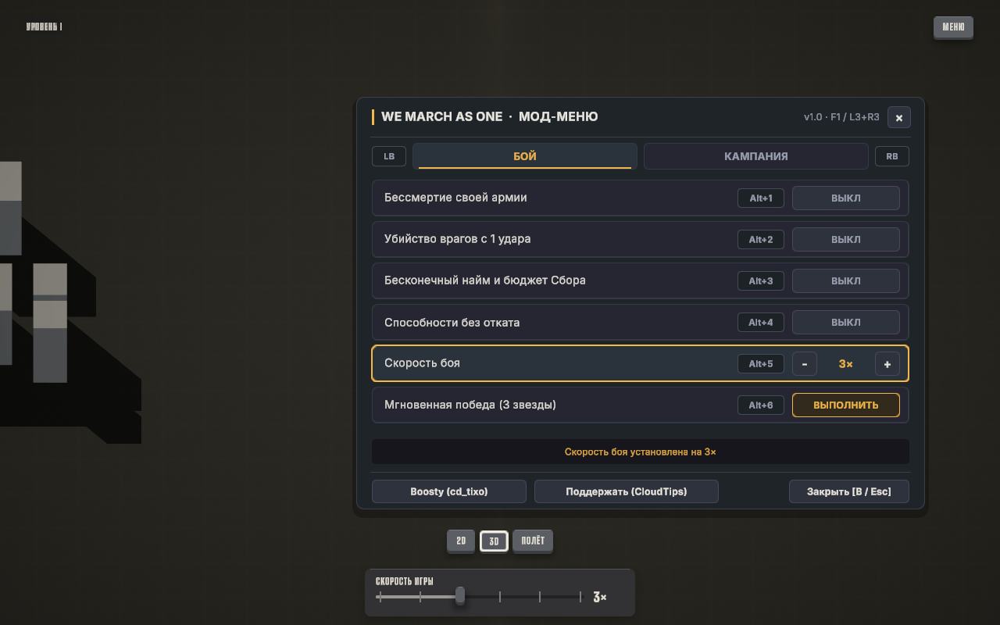
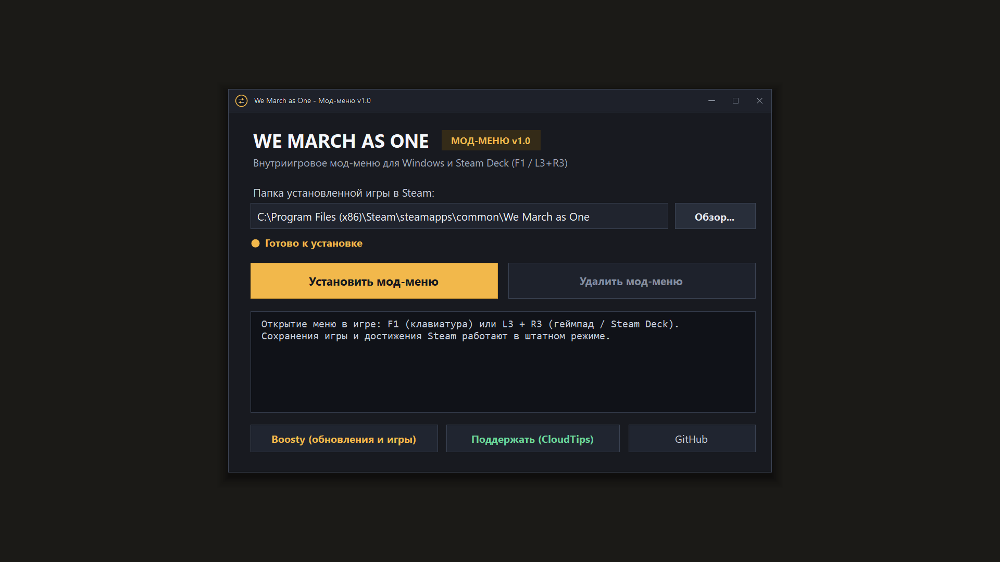

# We March as One · Мод-меню v1.0 для Windows

Внутриигровое меню с десятью функциями для боя и кампании.

**[Скачать мод-меню v1.0 (ZIP)](https://github.com/neoru-droid/we-march-as-one-trainer-ru/releases/download/v1.0.0/WeMarchAsOne-Trainer-RU-v1.0.zip)** · [Как установить](#установка)

Проверено на Windows в сборке Steam 26651298. Steam Deck пока не проверен на устройстве.

Меню открывается клавишей F1 или одновременным нажатием стиков L3 и R3.

Кнопка «Открыть всё» помечает все 50 уровней пройденными. Полученные ресурсы, прокачка и открытые уровни останутся в сохранении после удаления трейнера.

## Установка

Закройте игру, распакуйте ZIP и запустите WeMarchAsOne-Trainer-Setup.exe. Нажмите «Установить мод-меню». Для удаления снова откройте установщик и нажмите «Удалить мод-меню».

## Проверка на Steam Deck

Ищем добровольцев со Steam Deck. В архиве есть скрипт install-steamdeck.sh. Попробуйте открыть меню нажатием обоих стиков (L3 + R3), сменить вкладку кнопками LB/RB, включить и выключить бессмертие кнопкой A и закрыть меню кнопкой B во время боя. Напишите, удобно ли нажимать оба стика, читаются ли подписи и что стоит изменить. Укажите модель Deck, версию Proton и раскладку Steam Input. Отзыв можно оставить в [обсуждении ошибок и предложений](https://github.com/neoru-droid/we-march-as-one-trainer-ru/issues). Для теста в режиме рабочего стола распакуйте ZIP и выполните `sh install-steamdeck.sh` в папке с установщиком.

## Возможности (10 функций)

### Вкладка «Бой»
1. **Бессмертие своей армии** (`Alt+1`) - союзные отряды не теряют здоровье и не погибают в сражении.
2. **Убийство врагов с 1 удара** (`Alt+2`) - любая атака по вражескому юниту сразу выводит его из строя.
3. **Бесконечный найм и бюджет Сбора** (`Alt+3`) - снимает лимиты размещения на линиях, пополняет резерв и бюджет золота в режиме «Сбор».
4. **Способности без отката** (`Alt+4`) - открывает временное окно применения карт и сохраняет их заряды. После выключения снова действуют обычные ограничения. Приказы армии работают штатно.
5. **Скорость боя** (`Alt+5`) - переключение скорости сражения: `0.5x / 1x / 2x / 3x / 5x / 10x`.
6. **Мгновенная победа (3 звезды)** (`Alt+6`) - завершает текущий бой победой и присваивает три звезды на уровне кампании.

### Вкладка «Кампания»
7. **Золото и кристаллы славы** - кнопки быстрого начисления `+1 000 золота`, `+10 000 золота`, `+25 славы` и `+100 славы`.
8. **Множитель наград за бой** - увеличивает золото и кристаллы славы по итогам боя: `1x / 2x / 5x / 10x`.
9. **Прокачать всё древо и армию** - открывает все узлы древа навыков и доводит численность всех родов войск до максимума.
10. **Открыть все 50 уровней, режимы и песочницу** - открывает всю кампанию, режимы испытаний и полный набор войск в песочнице.

## Управление

- **Открыть / скрыть меню:**
  - Windows и Linux: `F1`
  - Steam Deck и геймпады: одновременное нажатие стиков `L3 + R3`
- **Быстрые клавиши в бою на ПК:** `Alt + 1` .. `Alt + 6` (работают без цифрового блока NumPad).
- **Навигация с геймпада / Steam Deck:** `LB / RB` - вкладки, крестовина вверх/вниз - выбор строки, крестовина влево/вправо - скорость и множитель, `A` - переключить или выполнить, `B` (или `Esc`) - закрыть окно.

## Как выглядит меню

**Вкладка «Бой», Windows, 1280×800**

**Вкладка «Кампания», Windows, 1280×800**

**Установщик**

