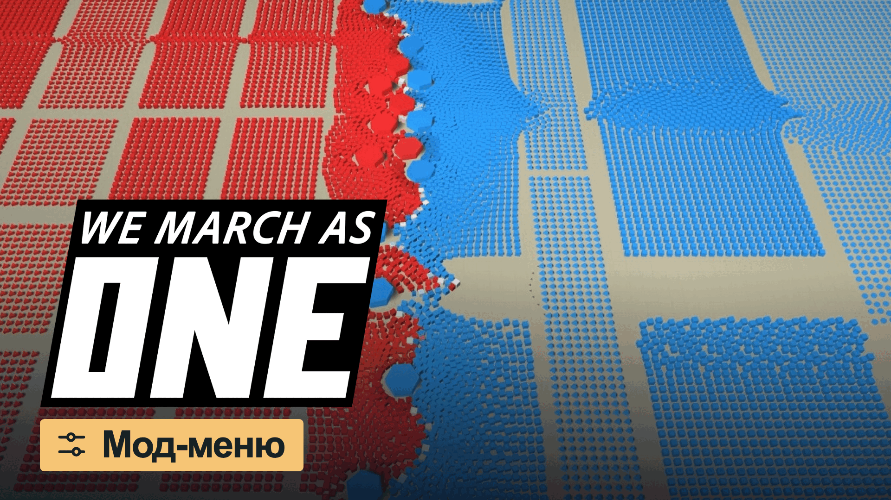
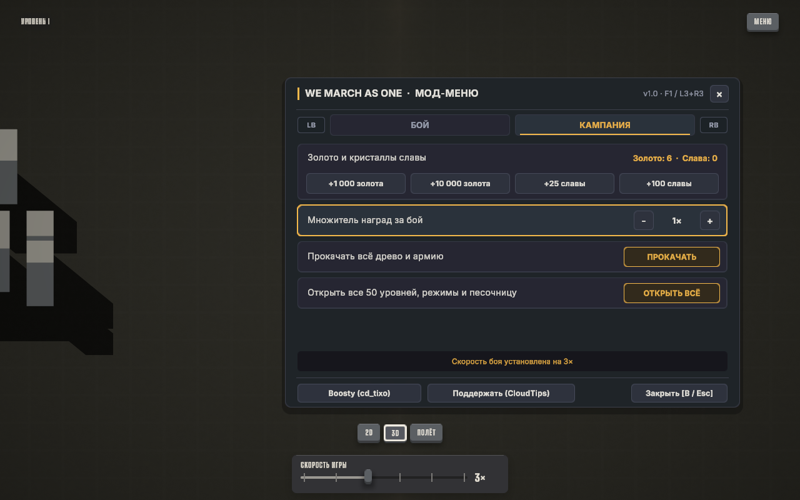

# We March as One · Внутриигровое мод-меню

Внутриигровое мод-меню на русском языке с десятью функциями настройки баланса для боя и кампании.

- **[Скачать мод-меню v1.0 (ZIP)](https://github.com/neoru-droid/we-march-as-one-trainer-ru/releases/download/v1.0.0/WeMarchAsOne-Trainer-RU-v1.0.zip)** · [Как установить](#установка)
- **[Единая страница с русификатором на Boosty (бесплатно, без регистрации)](https://boosty.to/cd_tixo/posts/73fae114-79d9-4305-99cc-8d8af1d157ce)**

Проверено на сборке Steam `26651298` для **Windows** (`F1`, `Alt+1..6`) и **Steam Deck / Linux** (`install-steamdeck.sh`, управление с геймпада `L3 + R3`). Достижения Steam продолжают открываться как обычно.

Кнопка «Открыть всё» помечает все 50 уровней пройденными. Полученные ресурсы, прокачка и открытые уровни останутся в сохранении после удаления мод-меню.

## Установка

1. **Windows:** закройте игру, распакуйте архив и запустите `WeMarchAsOne-Trainer-Setup.exe` -> **«Установить мод-меню»** (при окне SmartScreen: «Подробнее» -> «Выполнить в любом случае»).
2. **Steam Deck / Linux:** распакуйте все файлы архива в одну папку и выполните `sh install-steamdeck.sh` рядом с `WeMarchAsOne-Trainer-Setup.exe`.
3. **Удаление:** запустите установщик повторно и нажмите **«Удалить мод-меню»**. Совместимо с оригинальной игрой и с [русификатором текста](https://github.com/neoru-droid/we-march-as-one-ru) (оба пакета устанавливаются и удаляются в один клик в любом порядке).

## Возможности (10 функций)

### Вкладка «Бой»
1. **Бессмертие своей армии** (`Alt+1`) - союзные отряды не теряют здоровье и не погибают в сражении.
2. **Убийство врагов с 1 удара** (`Alt+2`) - любая атака по вражескому юниту сразу выводит его из строя.
3. **Бесконечный найм и бюджет Сбора** (`Alt+3`) - снимает лимиты размещения на линиях, пополняет резерв и бюджет золота в режиме «Сбор».
4. **Способности без отката** (`Alt+4`) - открывает временное окно применения карт и сохраняет их заряды. После выключения снова действуют обычные ограничения. Приказы армии работают нормально.
5. **Скорость боя** (`Alt+5`) - переключение скорости сражения: `0.5x / 1x / 2x / 3x / 5x / 10x`.
6. **Мгновенная победа (3 звезды)** (`Alt+6`) - завершает текущий бой победой и присваивает три звезды на уровне кампании.

### Вкладка «Кампания»
7. **Золото и кристаллы славы** - кнопки быстрого начисления `+1 000 золота`, `+10 000 золота`, `+25 славы` и `+100 славы`.
8. **Множитель наград за бой** - увеличивает золото и кристаллы славы по итогам боя: `1x / 2x / 5x / 10x`.
9. **Прокачать всё древо и армию** - открывает все узлы древа навыков и доводит численность всех родов войск до максимума.
10. **Открыть все 50 уровней, режимы и песочницу** - открывает всю кампанию, режимы испытаний и полный набор войск в песочнице.

*При каждом новом запуске игры боевые переключатели выключены. Между сеансами сохраняются только выбранная скорость боя и множитель наград.*

## Управление

- **Открыть / скрыть меню:**
  - Windows и Linux: `F1`
  - Геймпад и SteamOS: одновременное нажатие стиков `L3 + R3`
- **Быстрые клавиши в бою на ПК:** `Alt + 1` .. `Alt + 6` (работают без цифрового блока NumPad).
- **Навигация с геймпада:** `LB / RB` - вкладки, крестовина вверх/вниз - выбор строки, крестовина влево/вправо - скорость и множитель, `A` - переключить или выполнить, `B` (или `Esc`) - закрыть окно.

## Как выглядит меню

**Вкладка «Бой», Windows, 1280x800**

**Вкладка «Кампания», Windows, 1280x800**

**Установщик**

## Обратная связь и ссылки

Об ошибке можно написать в [Issues](https://github.com/neoru-droid/we-march-as-one-trainer-ru/issues).

[Все версии](https://github.com/neoru-droid/we-march-as-one-trainer-ru/releases) · [Русификатор We March as One](https://github.com/neoru-droid/we-march-as-one-ru) · [Каталог на Boosty](https://boosty.to/cd_tixo/posts/2a55d7e9-0f53-4d93-9f66-280981158dec) · [Разовые чаевые](https://pay.cloudtips.ru/p/240b8760)
